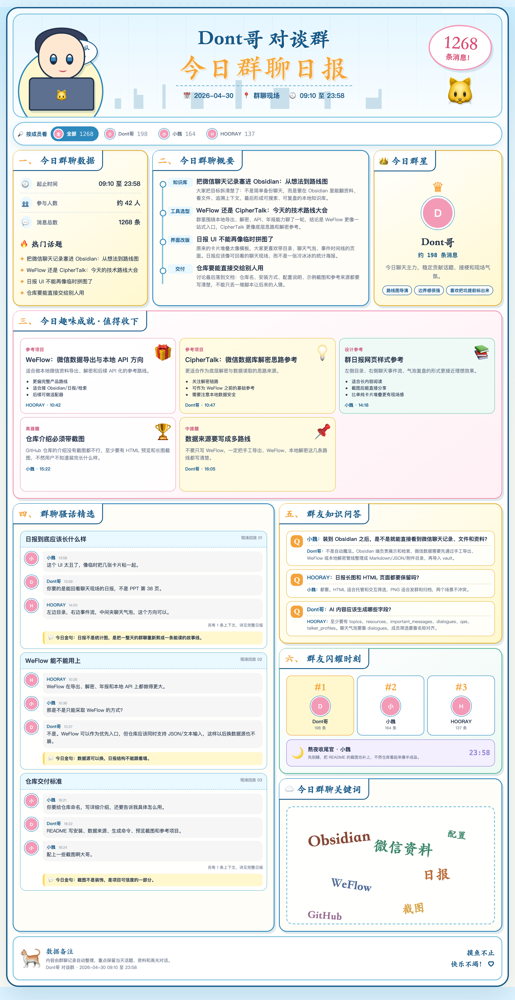
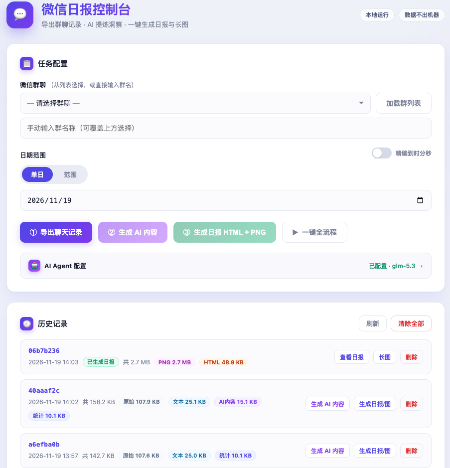

# WeChat Daily Report Skill

<!-- SIUSER-REPO-GUIDE:START -->
## 项目介绍 / Project Introduction

### 中文
微信群日报 Skill：把微信群聊整理成社区运营日报和 AI 摘要报告。

### English
WeChat group daily-report skill for turning chats into community operation reports and AI summaries.

## 使用方式 / Usage

### 中文
1. 先阅读 `SKILL.md`，确认触发场景、输入要求和执行步骤。
2. 按仓库 README 的安装方式复制或安装 Skill。
3. 在真实任务中调用前，先用示例或测试脚本做一次小范围验证。

### English
1. Read `SKILL.md` first to understand triggers, inputs, and workflow steps.
2. Install or copy the skill according to this README.
3. Before using it on real work, run a small example or validation script.

## 入口与元信息 / Entry Points & Metadata

- GitHub 仓库 / Repository: https://github.com/siuserxiaowei/wechat-daily-report-skill
- Live / 在线入口：https://siuserxiaowei.github.io/wechat-daily-report-skill/
- 默认分支 / Default branch: `main`
- 主要语言 / Primary language: `HTML`
- 可见性 / Visibility: `public`
- 仓库类型 / Repository type: `source`
- Topics / 主题：`daily-report`, `jinja2`, `obsidian`, `playwright`, `wechat`, `chat-report`

## 本地运行 / Local Run

```bash
git clone https://github.com/siuserxiaowei/wechat-daily-report-skill.git
cd wechat-daily-report-skill
python3 -m venv .venv
source .venv/bin/activate
pip install -r requirements.txt
```

## 仓库结构 / Repository Map

| 路径 / Path | 中文说明 | English |
| --- | --- | --- |
| `README.md` | 项目入口说明，先读这里。 | Main project entry point and orientation. |
| `SKILL.md` | Skill 的核心说明、触发条件和执行步骤。 | Core skill instructions, trigger rules, and workflow. |
| `requirements.txt` | Python 依赖列表。 | Python dependency list. |
| `index.html` | 静态站首页或页面入口。 | Static-site homepage or entry page. |
| `assets` | 图片、样式、数据等资源。 | Images, styles, data, and other assets. |
| `docs` | 文档或 GitHub Pages 输出目录。 | Documentation or GitHub Pages output. |
| `scripts` | 构建、同步、生成或维护脚本。 | Build, sync, generation, or maintenance scripts. |
| `examples` | 示例输入、用法或 fixture。 | Examples, usage samples, or fixtures. |
| `LICENSE` | 许可证文件。 | License file. |
| `agents` | Agent 配置或平台适配文件。 | Agent configuration or platform adapters. |
| `references` | 参考资料、规范或补充说明。 | References, specifications, or supporting notes. |
| `reports` | 项目文件或目录。 | Project file or directory. |

## 维护备注 / Maintenance Notes

- 中文：当项目目标、在线入口、运行命令或目录结构变化时，同步更新本说明。
- English: Keep this guide updated when the project purpose, live link, run commands, or structure changes.
- 中文：修改代码、数据或生成页面后，优先运行相关构建、测试或校验命令。
- English: After changing code, data, or generated pages, run the relevant build, test, or validation command.

## 安全与隐私 / Safety & Privacy

- 中文：不要提交 API key、token、密码、cookie、私有链接或内部账号资料。
- English: Do not commit API keys, tokens, passwords, cookies, private URLs, or internal account data.
- 中文：公开 GitHub Pages 前，确认资料已脱敏并允许公开。
- English: Before publishing GitHub Pages output, confirm the material is redacted and cleared for public release.
<!-- SIUSER-REPO-GUIDE:END -->


<!-- SIUSER-SEO-INTRO:START -->

## 项目介绍 / Project Introduction

**中文介绍**：微信群日报 Skill，用本地只读微信数据生成日报、长图和复盘素材，适合社群运营和信息整理。

**English**: A WeChat daily report skill that uses local read-only WeChat data to generate reports, long images, and review materials for community operations.

**SEO 关键词 / SEO Keywords**: WeChat daily report, community operations, AI summary, local data, 微信群日报

<!-- SIUSER-SEO-INTRO:END -->

把微信群聊天记录整理成一份可阅读、可截图、可归档的「群日报」。

这版重点重做了 UI，也把数据入口调整为优先使用 `jackwener/wx-cli`：`wx-cli` 负责从本机微信获取聊天记录，本仓库负责把记录整理成日报 HTML/PNG。

现在新增了一个本地 **Web 控制台**：在浏览器里完成导出、AI 内容生成、日报与长图渲染，支持精确到时分秒的查询、历史记录复用和 AI Agent 配置，全程只在本机运行。

## 预览



本仓库内置示例：

- [在线预览](https://siuserxiaowei.github.io/wechat-daily-report-skill/)
- [HTML 预览](examples/qun-ribao-demo.html)
- [PNG 长图](examples/qun-ribao-demo.png)

## 能做到什么

- 生成微信群「每日聊天记录报告」，也支持任意日期范围（周度/跨天复盘）
- 汇总今日话题、资源链接、重要消息、精彩对话、问答、成员输出
- 用聊天气泡还原关键对话，不只是统计数字
- 输出交互式 HTML 和可分享 PNG 长图
- 支持按成员过滤相关内容
- 默认用 `jackwener/wx-cli` 获取本地微信聊天记录
- 查询范围可精确到时分秒（wx-cli 按天粗取 + 本地秒级精过滤）
- 内置 AI Agent 自动撰写 `ai_content.json`，支持任何 OpenAI 兼容端点（OpenAI / DeepSeek / 阿里云 MaaS / 本地 Ollama 等）
- Web 控制台一键完成「导出 → AI 内容 → 日报 + 长图」全流程，历史记录可直接复用再加工
- 可以作为 Obsidian 归档素材：把 HTML/PNG/生成的 Markdown 放进 vault 即可

## 不能误解的地方

这不是 Obsidian 插件，也不是安装后自动打通微信的插件。

它是一个 Skill + 本地脚本工作流：先拿到微信聊天数据，再让 AI 生成结构化日报内容，最后渲染成 HTML/PNG。不想记命令的话，直接用 Web 控制台就能完成同样的流程。如果你想在 Obsidian 里长期查看聊天记录、附件和资料，需要再把导出的 Markdown/HTML/图片/附件目录放入 Obsidian vault。

## 数据来源怎么选

不是只能用 WeFlow。

| 方式 | 适合场景 | 说明 |
| --- | --- | --- |
| jackwener/wx-cli | 推荐主路线 | 直接查询本地微信聊天记录，本仓库已内置 `scripts/wx_cli_to_report.py` 适配 |
| 本地 wechat-cli 包 | 备用路线 | 如果装不了 `wx`，可以用你本地的 `wechat-cli` 二进制，通过 `--binary` 指定 |
| 手工导出的聊天文本/JSON | 快速试用 | 直接让 AI 按 `references/ai_prompt.md` 生成 `ai_content.json`，再渲染 |
| WeFlow | 后续扩展 | 适合做更完整的导出、解密、年报、本地 API |
| CipherTalk | 底层参考 | 更适合参考微信数据库解密与读取思路 |
| 旧版本地解密脚本 | 兼容路线 | 仓库仍保留旧脚本，但优先推荐 wx-cli |

更详细说明见 [数据来源说明](docs/data-sources.md)。

## 安装

```bash
git clone https://github.com/siuserxiaowei/wechat-daily-report-skill.git
cd wechat-daily-report-skill
python3 -m pip install -r requirements.txt
python3 -m playwright install chromium
```

安装 `wx-cli`：

```bash
npm install -g @jackwener/wx-cli
```

macOS 首次使用按 `wx-cli` 官方要求初始化：

```bash
codesign --force --deep --sign - /Applications/WeChat.app
killall WeChat && open /Applications/WeChat.app
sudo wx init
wx sessions
```

如果你要作为 Codex/Claude Skill 使用，也可以把仓库放到对应 skills 目录：

```bash
mkdir -p ~/.codex/skills
git clone https://github.com/siuserxiaowei/wechat-daily-report-skill.git ~/.codex/skills/wechat-daily-report-skill
```

## Web 控制台（推荐入口）

启动：

```bash
source .venv/bin/activate   # 或任意已 pip install -r requirements.txt 的环境
python3 web/app.py
```

浏览器打开 `http://127.0.0.1:8765`。



能做的事：

| 功能 | 说明 |
| --- | --- |
| 导出聊天记录 | 选群（可拉取群列表）、选单日/日期范围；打开「精确到时分秒」可按秒裁剪 |
| 生成 AI 内容 | 调用配置的 AI Agent 自动产出 `ai_content.json` |
| 生成日报 HTML + PNG | 渲染日报并截图长图，页面内可直接预览下载 |
| 一键全流程 | 导出 → AI 内容 → 日报 + 长图（未配密钥时自动跳过 AI 步骤） |
| 历史记录 | 每次导出按任务聚合展示；可对任意历史记录直接「生成 AI 内容」「生成日报/图」，也可单条删除或全部清除 |
| AI Agent 配置 | 页面内配置 Base URL / Model / API Key / Temperature / JSON mode，密钥存本地 `config/ai_agent.json`（0600 权限，已 gitignore，回显掩码） |

## 先跑一遍示例

从 wx-cli JSON 样例生成日报输入：

```bash
python3 scripts/wx_cli_to_report.py \
  --input-json examples/wx_cli_history_sample.json \
  --chatroom "Dont哥 对谈群" \
  --date 2026-04-30 \
  --output-stats examples/wx_stats_from_sample.json \
  --output-text examples/wx_simplified_chat_sample.txt
```

渲染内置完整示例：

```bash
python3 scripts/generate_report.py \
  --stats examples/sample_stats.json \
  --ai-content examples/sample_ai_content.json \
  --output examples/qun-ribao-demo.html
```

生成 PNG 长图：

```bash
python3 scripts/generate_report.py \
  --stats examples/sample_stats.json \
  --ai-content examples/sample_ai_content.json \
  --output examples/qun-ribao-demo.png \
  --viewport-width 1180 \
  --viewport-height 1400 \
  --device-scale-factor 2
```

## 生成真实群日报

### 1. 用 wx-cli 获取微信聊天记录

确认能看到最近会话：

```bash
wx sessions
```

把某个群当天记录转成日报输入：

```bash
python3 scripts/wx_cli_to_report.py \
  --chatroom "群名称或 chatroom id" \
  --date 2026-04-30 \
  --limit 5000 \
  --output-stats stats.json \
  --output-text simplified_chat.txt \
  --raw-output raw_wx_history.json
```

群聊身份在内部按稳定 ID 分组，日报和 `sender` 字段优先展示群昵称；没有群昵称时
展示原始微信昵称。对于只返回
错误 `sender` 字符串的旧版 wx-cli，脚本会从 `~/.wx-cli/cache` 的本地解密缓存中
恢复真实发送者并完成名称映射；稳定 ID 不会出现在日报页面。如果新版字段
和本地缓存都无法提供稳定身份，脚本才会停止生成，避免把消息串到错误成员名下。
只有明确接受旧数据风险时才添加 `--allow-unstable-senders`。

产物：

- `stats.json`：消息数、活跃成员、话唠榜、词云等统计数据
- `simplified_chat.txt`：压缩后的聊天文本，给 AI 生成日报内容用
- `raw_wx_history.json`：校正并清理内部身份字段后的聊天 JSON，便于排查

查日期范围或精确到时分秒，把 `--date` 换成 `--start` / `--end`（支持 `2026-04-30`、`2026-04-30 08:30`、`2026-04-30 08:30:00`，也可用 `T` 分隔）：

```bash
python3 scripts/wx_cli_to_report.py \
  --chatroom "群名称" \
  --start "2026-04-27 09:00:00" \
  --end "2026-04-30 23:59:59" \
  --output-stats stats.json \
  --output-text simplified_chat.txt
```

wx-cli 本身按天粗取，脚本会在本地按秒级区间精过滤，纯日期用法完全向后兼容。

### 2. 如果只能用本地 wechat-cli 包

你提到的 `wechat-cli-pkg.tar.gz` 也能用。解压后直接把二进制路径传给适配器：

```bash
tar -xzf /path/to/wechat-cli-pkg.tar.gz -C /tmp/wechat-cli-pkg
python3 scripts/wx_cli_to_report.py \
  --binary /tmp/wechat-cli-pkg/wechat-cli-pkg/wechat-cli/node_modules/@canghe_ai/wechat-cli-darwin-arm64/bin/wechat-cli \
  --chatroom "群名称或 chatroom id" \
  --date 2026-04-30 \
  --limit 5000 \
  --output-stats stats.json \
  --output-text simplified_chat.txt
```

### 3. 生成 AI 内容

#### 3a. 自动：调用 AI Agent（推荐）

首次使用先准备配置：

```bash
cp config/ai_agent.example.json config/ai_agent.json
# 编辑 config/ai_agent.json，填入 base_url / model / api_key
```

然后一条命令自动生成 `ai_content.json`：

```bash
python3 scripts/generate_ai_content.py \
  --stats stats.json \
  --output ai_content.json
```

脚本只用标准库 urllib 请求 OpenAI 兼容的 `/chat/completions` 接口，无额外 SDK；自动从 `stats.json` 里记录的文本路径读取聊天记录，按提示词模板生成结构化 JSON，并把 `talker_profiles` 对齐到 `top_talkers`。配置优先级：命令行参数 > 环境变量（`WECHAT_AI_BASE_URL` / `WECHAT_AI_MODEL` / `WECHAT_AI_API_KEY`，兼容 `OPENAI_API_KEY`）> 配置文件 > 内置默认。macOS 上若报 SSL 证书错误，先 `pip install certifi`（已在 requirements 中），仍不行可加 `--insecure` 临时跳过校验。

#### 3b. 手动：交给对话中的 AI

把下面三个东西一起交给 AI：

- `references/ai_prompt.md`
- `stats.json`
- `simplified_chat.txt`

要求 AI 只输出合法 JSON，保存为：

```text
ai_content.json
```

### 4. 渲染日报

生成交互式网页：

```bash
python3 scripts/generate_report.py \
  --stats stats.json \
  --ai-content ai_content.json \
  --output report.html
```

生成可分享长图：

```bash
python3 scripts/generate_report.py \
  --stats stats.json \
  --ai-content ai_content.json \
  --output report.png \
  --viewport-width 1180 \
  --viewport-height 1400 \
  --device-scale-factor 2
```

## 常见问题 / FAQ

| 现象 | 处理 |
| --- | --- |
| 页面打不开 / 端口被占 | 确认 `python3 web/app.py` 在运行；排查：`lsof -nP -iTCP:8765 -sTCP:LISTEN`，结束旧进程后重启 |
| AI 生成报 `CERTIFICATE_VERIFY_FAILED` | macOS 上 Python 缺 CA 证书，先 `pip install certifi`（已在 requirements 中）；仍不行可在页面勾选「跳过 SSL 校验」或命令行加 `--insecure` |
| AI 生成报「缺少 api_key」 | 在页面「AI Agent 配置」保存密钥，或 `cp config/ai_agent.example.json config/ai_agent.json` 后填写 |
| 群列表加载失败 | 先完成 wx-cli 初始化（见上方安装章节），确认 `wx sessions` 在终端能正常输出 |
| PNG 长图生成失败 | 执行过 `python3 -m playwright install chromium`；生成耗时较长，页面会持续显示运行日志 |
| 导出结果为空 | 确认群名与微信内显示一致（支持群 ID）；检查日期范围是否真的有过消息，时分秒开关是否把区间卡得太窄 |

## 放进 Obsidian

推荐目录：

```text
YourVault/
  WeChat/
    DailyReports/
      2026-04-30-report.html
      2026-04-30-report.png
      2026-04-30-ai_content.json
      2026-04-30-stats.json
```

你可以在 Obsidian 里新建一篇笔记：

```markdown
# 2026-04-30 群日报

![[2026-04-30-report.png]]

HTML 交互版：[[2026-04-30-report.html]]
```

## 项目结构

```text
web/app.py                       # Flask Web 控制台（导出/AI/日报/历史/配置，端口 8765）
web/templates/index.html         # 控制台单页前端
config/ai_agent.example.json     # AI Agent 配置模板（复制为 ai_agent.json 使用）
assets/report_template.html      # 新版日报 UI 模板
assets/contact/                  # 公众号与个人微信二维码
assets/screenshots/              # Web 控制台界面截图
scripts/wx_cli_to_report.py      # wx-cli/wechat-cli 转日报输入（支持秒级精过滤）
scripts/generate_ai_content.py   # 调用 AI Agent 自动生成 ai_content.json
scripts/analyze_chat.py          # 从本地微信数据生成 stats/simplified_chat
scripts/generate_report.py       # Jinja2 渲染 HTML，并用 Playwright 输出 PNG
references/ai_prompt.md          # AI 生成 ai_content.json 的提示词
examples/                        # 示例数据、HTML 和长图截图
docs/data-sources.md             # 数据来源和 WeFlow/CipherTalk 接入说明
SKILL.md                         # 给 Codex/Claude 使用的 Skill 说明
```

## 参考来源

- 首选数据入口：[jackwener/wx-cli](https://github.com/jackwener/wx-cli)
- UI 方向参考：[群日报示例页面](https://simonlin000.github.io/qun-riba-20260430/)
- 原始 skill 思路参考：[ADVISORYDZ/wechat-daily-report-skill](https://github.com/ADVISORYDZ/wechat-daily-report-skill)
- 数据导出方向参考：[hicccc77/WeFlow](https://github.com/hicccc77/WeFlow)
- 微信解密思路参考：[ILoveBingLu/CipherTalk](https://github.com/ILoveBingLu/CipherTalk)

## License

MIT

<!-- SIUSER-CONTACT:START -->

## 联系我 / Contact

想交流 AI 工具、内容自动化、社群运营或项目合作，欢迎扫码联系。

For collaboration on AI tools, content automation, community operations, or product experiments, scan the QR codes below.

<table>
  <tr>
    <td align="center" width="50%">
      <b>微信公众号</b><br/>
      使用技巧 · 更新动态 · 实战案例<br/><br/>
      
    </td>
    <td align="center" width="50%">
      <b>个人微信</b><br/>
      扫码加我为朋友，交流项目与合作<br/><br/>
      
    </td>
  </tr>
</table>

**关键词 / Keywords**: WeChat daily report, community operations, AI summary, local data, AI tools, AI automation, GitHub Pages, SEO

<!-- SIUSER-CONTACT:END -->
